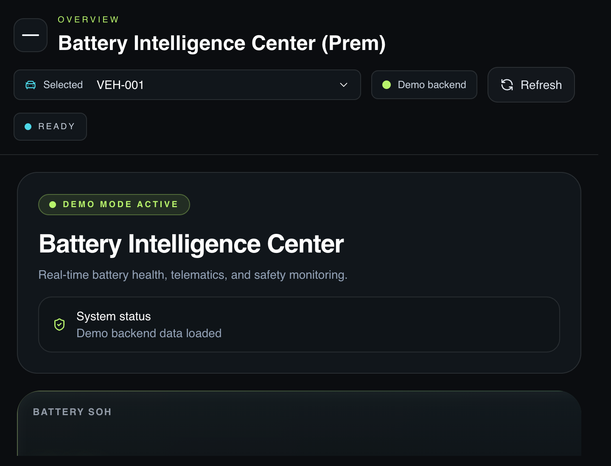
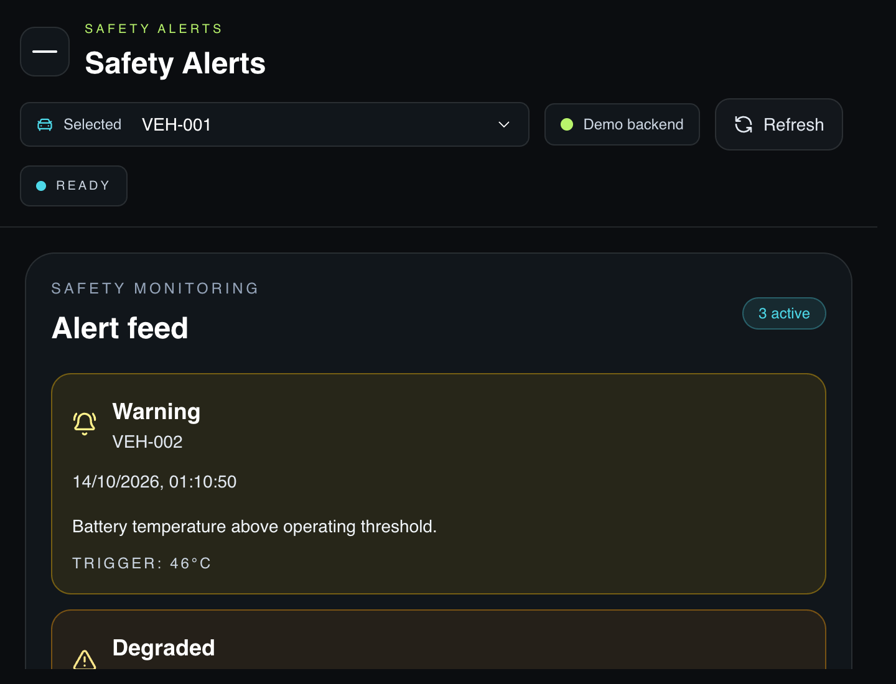

# Battery Intelligence Center

**A full-stack EV battery health and fleet-monitoring demo.** The application combines a responsive telemetry dashboard, a REST API, persistent PostgreSQL storage, safety alerts, and public EV-related data sources.

- **Live demo:** [battery-intelligence-center.vercel.app](https://battery-intelligence-center.vercel.app/)
- **API health:** [Production health check](https://battery-intelligence-center.vercel.app/api/health)
- **Source:** [prem-479/Battery-Intelligence-Center](https://github.com/prem-479/Battery-Intelligence-Center)

> **Data note:** Battery readings, fleet records, and alerts in the public demo are sample data; they are not live readings from a vehicle battery-management system (BMS). The API is deployed and persists demo data in Neon Postgres. Weather, mapped charging stations, and VIN specifications use public data providers.

## Screenshots

| Fleet overview | Safety alert feed |
| --- | --- |
|  |  |

The application also includes a thermal-intelligence view with a transparent, rule-based assessment of the selected vehicle's available pack-temperature telemetry.

## Portfolio summary

Battery Intelligence Center is a portfolio project exploring how EV telemetry can be presented as a useful fleet-operations experience. It brings vehicle health indicators, time-series telemetry, fleet summaries, public charging and weather context, and prioritized safety alerts into one responsive interface.

### Highlights

- Built a responsive, dark-themed dashboard with fleet summaries, vehicle selection, state-of-health indicators, telemetry charts, and safety alerts.
- Added a thermal-intelligence view with temperature-history summaries, freshness checks, explicit risk thresholds, and clear sample-data provenance.
- Added a tested thermal rule baseline that flags critical temperatures, warnings, stale telemetry, and non-zero fault codes without claiming predictive AI.
- Implemented a typed React and TypeScript frontend and an Express REST API, with routes for overview data, vehicles, alerts, telemetry, and public-data lookups.
- Connected a Vercel serverless API to Neon Postgres for durable demo-state storage; retained a local JSON-file store for local/Docker use.
- Made database initialization safe under concurrent serverless requests and serialized demo writes with PostgreSQL transactions and advisory locks.
- Integrated three public, no-key data sources: Open-Meteo weather, OpenStreetMap charging-station data via Overpass, and NHTSA vPIC VIN decoding.
- Added demo-only mode so visitors can explore the sample experience without connecting a wallet or signing in.
- Included an Ethers.js smart-contract integration path and a reference Solidity contract for a future on-chain deployment.

### CV-ready project entry

**Battery Intelligence Center — Full-Stack EV Battery Monitoring Demo**

React · TypeScript · Express · PostgreSQL · Vercel · Neon · Solidity · Ethers.js

- Designed and deployed a full-stack EV fleet dashboard with **10 REST API routes**, covering fleet summaries, vehicles, telemetry, alerts, health checks, and public-data lookups.
- Integrated **3 public data providers** and built a persistent serverless backend with transaction-safe PostgreSQL writes.
- Verified the production homepage, health and overview APIs, nested telemetry and thermal-assessment APIs, and both documented screenshot assets with successful HTTP responses.
- Implemented demo-mode safeguards that distinguish sample battery telemetry from live external data and on-chain contract data.
- Added a thermal risk baseline with documented temperature/freshness thresholds and automated unit tests; the interface explicitly distinguishes pack history from unavailable cell-level data.

### Quantified scope

| Measure | Result |
| --- | ---: |
| REST API routes | 11 |
| Public data integrations | 3 |
| Persistence modes | 2 — local JSON and Neon Postgres |
| Wallet or sign-in required for the demo | 0 |
| Production smoke checks verified | 7 — homepage, 4 API routes, 2 screenshots |
| Thermal rule-baseline tests | 5 |

## Technology

| Area | Technologies |
| --- | --- |
| Frontend | React, TypeScript, Vite, Tailwind CSS, Recharts, Lucide |
| Backend | Node.js, Express, REST |
| Persistence | Neon Postgres, `@neondatabase/serverless`, local JSON store |
| Web3 extension | Solidity, Ethers.js |
| Deployment | Vercel Hobby, Neon Free |
| Public data | Open-Meteo, OpenStreetMap Overpass, NHTSA vPIC |

## Architecture and reliability

- Vercel serves the Vite-built frontend and routes API requests to Express serverless functions on the same origin; a nested dynamic route handles vehicle telemetry and thermal-assessment paths.
- Neon Postgres stores the demo fleet state in a JSONB-backed row. Schema creation is initialized under a PostgreSQL advisory lock to prevent concurrent first-request creation races.
- `GET /api/vehicles/:vehicleId/thermal-assessment` applies the shared deterministic thresholds to the stored latest reading and returns a history summary, the thresholds, and a data-provenance notice. It does not persist a separate thermal model result.
- Demo writes run transactionally and use an advisory lock to avoid overlapping updates to the shared sample state.
- Local development and Docker can use `backend/data/store.json`; production requires `DATABASE_URL` and does not silently fall back to Vercel's ephemeral filesystem.
- The UI reports public-provider failures rather than treating unavailable external data as successful responses.

## API

| Method | Endpoint | Purpose |
| --- | --- | --- |
| `GET` | `/api/health` | API and persistent-store health |
| `GET` | `/api/overview` | Fleet summary, alerts, and latest telemetry |
| `GET` | `/api/vehicles` | Registered vehicle list |
| `GET` | `/api/vehicles/:vehicleId/telemetry` | Telemetry history for a vehicle |
| `GET` | `/api/vehicles/:vehicleId/thermal-assessment` | Rule-based assessment and temperature-history summary |
| `GET` | `/api/alerts` | Safety alert records |
| `GET` | `/api/public/weather?latitude=...&longitude=...` | Current weather from Open-Meteo |
| `GET` | `/api/public/charging-stations?latitude=...&longitude=...&radius=5000` | Nearby mapped charging stations from OpenStreetMap Overpass |
| `GET` | `/api/public/vehicle-specs/:vin` | VIN decode through NHTSA vPIC |
| `POST` | `/api/vehicles` | Register a demo vehicle |
| `POST` | `/api/telemetry` | Submit a demo telemetry reading |

### Data and privacy

- **Battery telemetry is simulated.** Free public APIs cannot provide private BMS readings from a vehicle.
- The thermal-intelligence view applies transparent rules to available pack-level sample/backend readings: below 15°C or above 40°C is a warning, 45°C and above is critical, non-zero fault codes are critical, and non-critical readings older than 15 minutes are stale. These are project thresholds, not certified vehicle safety limits.
- Temperature summaries describe change across recorded readings over time. They do not estimate simultaneous cell-to-cell spread. The 10-cell, 21700, 1 mm channel, Reynolds 400–700, and water-based Al₂O₃ configuration is a research concept only; the app has no per-cell sensors, coolant measurements, CFD outputs, or thermal simulation results.
- No validated thermal dataset, trained predictive model, calibrated uncertainty estimate, or AI-based temperature prediction is included.
- Weather and charging-station results are fetched from public providers and may be incomplete, rate-limited, or temporarily unavailable.
- A VIN is sent to NHTSA vPIC only when a visitor explicitly submits it; it is not written to the demo store.
- Coordinates are sent to the relevant public providers to fulfill requests and are not written to the demo store.
- This unauthenticated demo is for evaluation with sample data only. Do not submit private vehicle, customer, or other sensitive information.

## Run locally

### Requirements

- Node.js 22 or newer
- npm 9 or newer

Install dependencies and start the frontend:

```bash
npm install
npm run dev
```

Run the frontend and API together:

```bash
npm run dev:full
```

The local API listens on `http://localhost:4000` and persists data in `backend/data/store.json`.

### Docker

```bash
docker compose up --build
```

Open `http://localhost:4000`. Mount persistent storage at `/app/backend/data` if local demo records should survive container replacement.

### Build and lint

```bash
npm run build
npm run lint
npm run test:thermal
```

## Deployment

The public app is deployed at [battery-intelligence-center.vercel.app](https://battery-intelligence-center.vercel.app/), with the Express API running as a Vercel serverless function and Neon Postgres backing durable demo storage.

To deploy your own instance:

1. Import this repository into Vercel with the repository root as the project root. `vercel.json` configures the Vite frontend build and API function.
2. Create or select a Neon database and set its **pooled PostgreSQL connection URL** as `DATABASE_URL` in the Vercel Production environment. Keep the value in the dashboard; never commit it to Git.
3. Leave `VITE_API_URL` unset so the frontend uses same-origin `/api` routes. The default demo configuration does not require a wallet or login.
4. Redeploy after configuring environment variables.
5. Verify `/api/health` returns `"ok": true`, then load `/api/overview`.

Vercel Hobby and Neon Free are subject to provider quotas and terms that can change. Check current limits before relying on the demo for ongoing use.

## Smart-contract extension

The frontend includes an Ethers.js integration path for a contract exposing:

- `owner()`, `authorizedOracle()`, and `registeredVehicles(bytes32)`
- `registerVehicle(bytes32)`, `setOracle(address)`, and `logVehicleHealth(bytes32,uint256,uint256,uint256,uint256)`
- `getLatestHealth(bytes32)` and `vehicleHistory(bytes32,uint256)`
- `HealthLogged` and `AlertTriggered` events

A reference contract is available in [`contracts/EVHealthMonitor.sol`](./contracts/EVHealthMonitor.sol). Configure `VITE_CONTRACT_ADDRESS` and `VITE_CHAIN_ID` for a deployed contract. Vehicle IDs are encoded with `ethers.encodeBytes32String(vehicleId)`. The public demo does not claim that sample data is an on-chain transaction.

## Repository

- [Live application](https://battery-intelligence-center.vercel.app/)
- [Production API health](https://battery-intelligence-center.vercel.app/api/health)
- [GitHub source repository](https://github.com/prem-479/Battery-Intelligence-Center)
- [Latest Vercel production deployment](https://vercel.com/prem-479/battery-intelligence-center/8Fppzt9Myi9HMH1SM6Wsv7GrhfCd)
